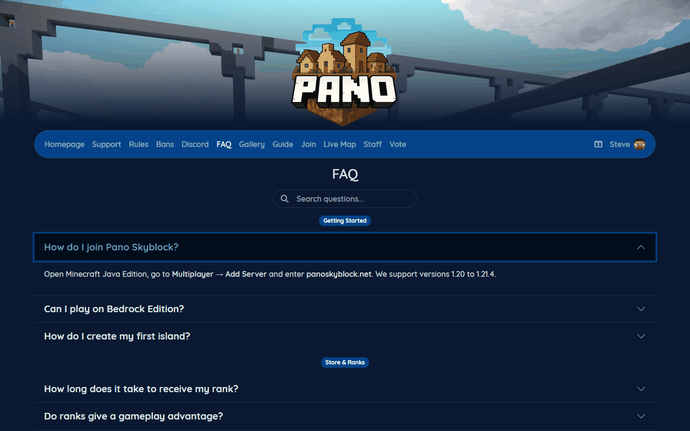
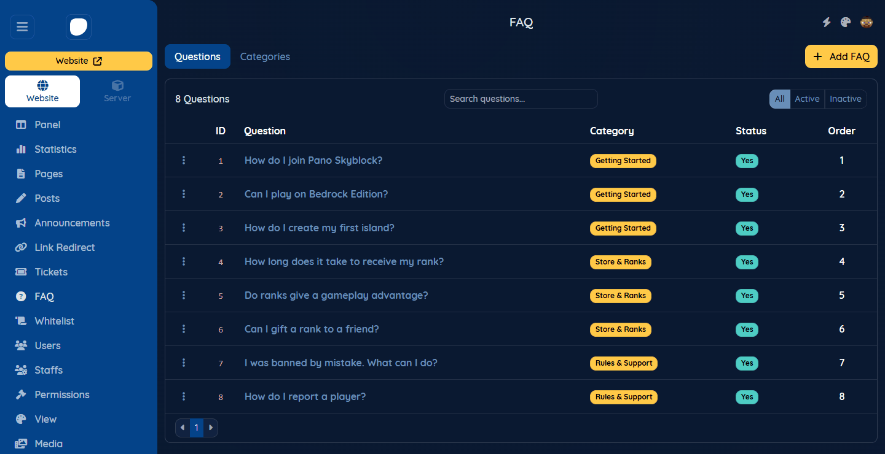
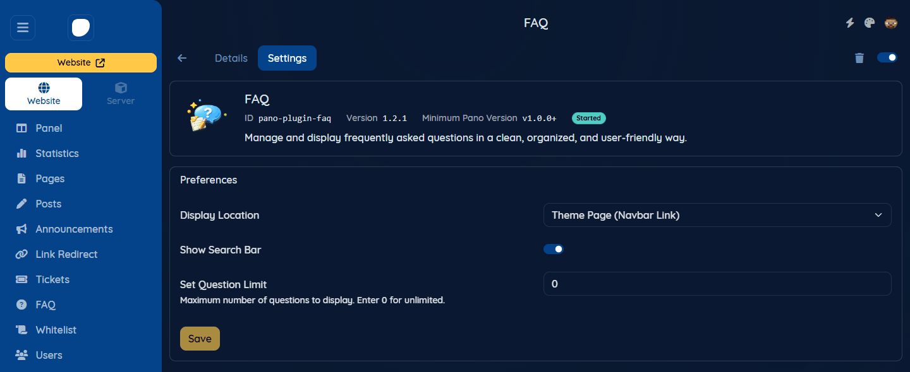

  
  <h1>FAQ</h1>
  
<b>Answer your players' questions before they even ask.</b>

  

    
    
    
  

FAQ adds a clean Frequently Asked Questions page to your Pano website. Group your questions into categories, let players search for what they need, and spend less time answering the same questions in tickets and chat.

## ✨ Features
- 📂 **Categories**: Sort questions into groups like "Getting Started" or "Store & Ranks".
- 🔍 **Search bar**: Players type a word and find the right answer in seconds.
- 🧭 **Choose where it shows**: Show the FAQ as its own page in the menu or on your Support page.
- ↕️ **Your order**: Decide which questions come first.
- 👁️ **Show or hide**: Turn single questions off without deleting them.
- 🔢 **Question limit**: Show only your top questions, or all of them.
- ✍️ **Rich answers**: Use bold text and links to make answers easy to read.

## 📸 Screenshots

<i>All your questions in one list in the panel.</i>

<i>Pick where the FAQ appears, turn search on or off and set a question limit.</i>

## 🚀 Get started
1. Open your Pano panel and go to **Addons**.
2. Find **FAQ** and click **Install**.
3. Open **FAQ** in the panel, create a category and add your first question.

## 💬 Support
Questions or ideas? Join our [Discord](https://panomc.com/discord) or visit [panomc.com](https://panomc.com).

## 📄 License
Released under the MIT License.
